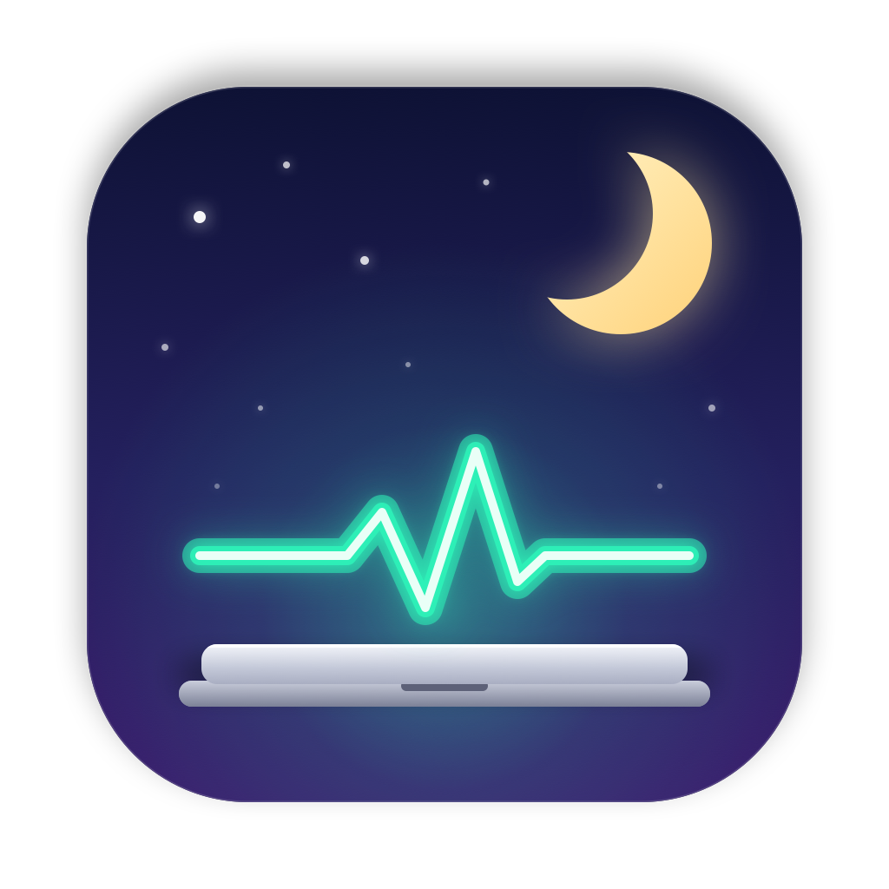
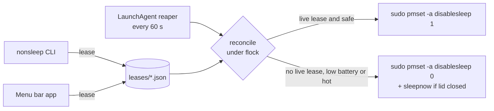

<p align="center"></p>

# NonSleep

Keep your Mac working **with the lid closed** while your AI coding agents run — and let it sleep again the moment they finish.

`caffeinate`, Amphetamine's basic mode, and agents' own "prevent sleep" settings all use `IOPMAssertion`, which only blocks *idle* sleep. Closing the lid still sleeps the Mac. The only switch that survives a closed lid is the system flag `pmset disablesleep 1`, which needs root and is easy to forget on. NonSleep turns that flag on only while something actually needs it, and guarantees it turns off again.

- **Agent-aware.** [omp](https://github.com/can1357/oh-my-pi) holds an `"omp agent session"` power assertion exactly while a prompt is in flight, in every project and with every provider; NonSleep watches for it (and for `caffeinate`). Claude Code, Cursor and Antigravity report their turns through official hooks that `nonsleep integrate` installs. A closed MacBook keeps running a long turn — in a terminal, an IDE, or inside Orca — and sleeps when it's done.
- **Menu bar app + CLI**, sharing one state: `nonsleep run claude`, `nonsleep on 3h`, `nonsleep wait 1234`.
- **Fail-safe.** Every request is a *lease* tied to a process, an expiry, and the current boot. Crash, `kill -9`, or reboot → the lease dies → a LaunchAgent reaper (every 60 s) restores normal sleep on its next run.
- **Safety cut-outs.** Suspended on battery below 20% and when macOS reports serious/critical thermal state. When the flag drops with the lid closed (and no external display), the Mac sleeps immediately.
- **Minimal privilege.** A sudoers rule that allows exactly `pmset -a disablesleep 0` and `… 1`. No helper daemon running as root, no network access, no telemetry.

## Install

### Download (macOS 13+)

1. Download `NonSleep-X.Y.Z-macOS.zip` from [Releases](../../releases/latest), unzip, and move
   **NonSleep.app** to `/Applications` or `~/Applications`. It's a universal app (Apple silicon and Intel).
2. The app is ad-hoc signed, not notarized, so the first launch is blocked. Open it once, then go to
   *System Settings › Privacy & Security* and click **Open Anyway**, or run
   `xattr -dr com.apple.quarantine /Applications/NonSleep.app`.
3. The NonSleep window opens: click **Finish setup…** and approve the administrator dialog.

Check the download against `SHA256SUMS.txt` from the same release: `shasum -a 256 NonSleep-*.zip`.

### From source

Requires the Swift toolchain (Xcode or Command Line Tools).

```sh
git clone <this repo> && cd non-sleep
scripts/install.sh        # builds, installs ~/Applications/NonSleep.app, runs `nonsleep setup`
nonsleep status
```

### What setup installs

*Finish setup…* and `nonsleep setup` do the same thing; only the sudoers step needs the administrator dialog:

| What | Where |
| --- | --- |
| sudoers rule | `/etc/sudoers.d/nonsleep` |
| Reaper LaunchAgent (`nonsleep reap` at login + every 60 s) | `~/Library/LaunchAgents/dev.nonsleep.reaper.plist` |
| CLI symlink | `~/.local/bin/nonsleep` → the CLI inside the app |

The rule, validated with `visudo -c` before it's installed:

```
you ALL=(root) NOPASSWD: /usr/bin/pmset -a disablesleep 0, /usr/bin/pmset -a disablesleep 1
```

Uninstall: `scripts/uninstall.sh`, or `nonsleep integrate all --remove && nonsleep setup --remove`
and delete the app. Either way normal sleep is restored first.

### Linux (CLI)

Laptops on systemd distributions suspend on lid close by default (`HandleLidSwitch=suspend`). NonSleep for Linux is the same CLI (`status`, `on`, `run`, `wait`, `auto`, `integrate`, hooks…), no menu bar app, and **no root**:

```sh
tar -xzf nonsleep-X.Y.Z-linux-x86_64.tar.gz && cd nonsleep-X.Y.Z-linux-x86_64   # or -aarch64
./install.sh          # ~/.local/bin/nonsleep + autostart `nonsleep auto` in your desktop session
nonsleep status
```

From source: `scripts/install-linux.sh` (needs Swift 6). Uninstall: `./uninstall.sh` / `scripts/uninstall-linux.sh`.

How it differs from macOS:

- Lid-closed mode is a logind **inhibitor lock** (`handle-lid-switch:sleep`, block mode) held by a small `nonsleep keeper` process that exists only while a live lease does. If it or `systemd-inhibit` dies, logind drops the lock, so there's no sudoers rule and no reaper.
- omp holds a login1 inhibitor while a turn runs; NonSleep reads it via `busctl … ListInhibitors`. Hooks for Claude Code, Cursor and Antigravity work the same as on macOS.
- Lock on lid close uses `loginctl lock-session`; "sleep now" uses `systemctl suspend`. There's no thermal cut-out on Linux (battery cut-out only).
- Polkit lets processes in your **active local session** take these locks; over SSH they're refused. That's why `install.sh` uses desktop autostart for `nonsleep auto` rather than a `systemd --user` service.
- State lives in `~/.local/state/nonsleep`, config in `~/.config/nonsleep/config.json`.

## Use

### Menu bar and window

The moon (`moon.zzz`) means normal sleep, the pulse (`waveform.path.ecg`) means the lid can close, and ⚠︎ means a safety cut-out paused it or something failed.

The menu has the essentials:

- **Auto: while agents are working** (on by default)
- **Keep awake** → 1 h / 3 h / 8 h / until turned off
- **Turn off** releases every lease, including ones made from the CLI, and disables auto mode
- **Sleep now** releases everything and sleeps the Mac. While NonSleep holds the Mac awake, macOS ignores the Apple-menu Sleep item and the power button; this always works. Auto mode pauses until you wake the screen, so a dark wake can't re-arm it.
- **Open NonSleep…** (⌘,) opens the window

The window also opens when you open the app again from Finder/Spotlight, and on first launch or while setup is incomplete. It shows what is holding the Mac awake (with **Release** per lease), which agents are working, every config setting (saved straight to `config.json`), **Launch at login**, and a setup check (sudoers rule, reaper, screen-lock delay). The app sits in the Dock only while the window is open.

**Lock on lid close** (on by default): when the lid closes while NonSleep keeps the Mac awake, and no external display is attached, the app turns the display off (`pmset displaysleepnow`). Without this, a closed-but-awake Mac stays unlocked: whoever opens the lid is straight in. The lock only happens if *System Settings › Lock Screen › Require password after screen saver begins or display is turned off* is **Immediately**; the setup check shows the current value.

Leases held by the app die with the app: quitting releases them, and if nothing else holds a lease, normal sleep returns (immediately, if the lid is closed).

Logs: `log show --last 1h --predicate 'subsystem == "dev.nonsleep.app"'`.

### CLI

```text
nonsleep status               lid-closed mode, leases, agent activity, power
nonsleep on [DURATION]        detached: until `off`, DURATION (90m, 3h, 1h30m), or reboot
nonsleep off                  release every lease, restore normal sleep
nonsleep sleep                release every lease and sleep now
nonsleep run [--] CMD…        hold while CMD runs; exits with CMD's status
nonsleep wait TARGET…         hold while PIDs or process names (claude, omp) run
nonsleep auto                 headless auto mode (same logic as the menu bar app)
nonsleep reap                 sweep dead leases, re-apply state (LaunchAgent)
nonsleep config               print config path and effective config
nonsleep integrate [AGENT…]   add hooks for claude / cursor / antigravity / all (--remove to undo); no AGENT: status
nonsleep hook AGENT EVENT     what those hooks call (event JSON on stdin; always exits 0)
```

`run` spawns the command in your terminal's foreground process group, so interactive TUIs keep working and Ctrl-C goes straight to them.

`off` (and **Turn off** in the menu) drops the leases that exist *now*. A `run`, `wait`, or `auto` process that is still running takes its lease back on its next tick (10–15 s), so stop that process if you want it to stay off.

### Agents

| Agent | How NonSleep sees it |
| --- | --- |
| omp | Built in: the `"omp agent session"` assertion, held only while a turn is in flight, for every session, project and provider (omp setting `power.sleepPrevention` must not be `off`). |
| Claude Code | `nonsleep integrate claude` → hooks in `~/.claude/settings.json` (`UserPromptSubmit`, `PostToolUse` hold; `Stop`, `StopFailure`, `Notification`, `SessionEnd` release). |
| Cursor (IDE agent) | `nonsleep integrate cursor` → hooks in `~/.cursor/hooks.json` (`beforeSubmitPrompt` and post-tool events hold; `stop`, `sessionEnd` release). Only observe-only events are used, so NonSleep never approves or blocks a tool call. |
| Antigravity (App, IDE, CLI) | `nonsleep integrate antigravity` → a `nonsleep` entry in `~/.gemini/config/hooks.json` (`PreInvocation`, `PostToolUse` hold; `Stop` releases once `fullyIdle`). |
| Agents inside Orca | Detected the same way as in any terminal. To hold while Orca is open at all, add `"Orca"` to `processNames`. |
| Anything else | `nonsleep run <cmd>`, `caffeinate -i <cmd>`, or `nonsleep wait <pid>`. |

Hook integrations: `nonsleep integrate` shows what's installed, `nonsleep integrate all` installs everything, `--remove` takes it out again (the window has a toggle per agent). NonSleep only adds or removes its own entries; other hooks in those files (Orca's, for example) are left as they are, and the first edit saves a `.nonsleep-backup` copy. The rewritten file is pretty-printed with sorted keys.

Each turn's lease belongs to the agent process that ran the hook (the first ancestor that isn't a shell), so it dies with the agent, and expires `hookTimeoutMinutes` after the agent's last hook event. That covers turns that end without a stop event (Claude Code skips `Stop` on user interrupt). A single tool call that runs longer than that without any hook firing (a long build) can let the lease lapse; wrap it in `nonsleep run` or raise the timeout. Cursor's CLI (`cursor-agent`) does not emit `beforeSubmitPrompt`/`stop`, so it only holds from post-tool events.

`processNames` match the executable name or the script an interpreter runs (`bun …/omp` matches `omp`). Presence alone counts, so an idle `claude` session keeps the Mac awake; prefer hooks, `run`, or the assertion signal when you can.

### Config

`~/Library/Application Support/NonSleep/config.json` — every key optional:

```json
{
  "assertionNames": ["omp agent session", "caffeinate"],
  "processNames": [],
  "minBatteryPercent": 20,
  "graceSeconds": 120,
  "sleepWhenDone": true,
  "lockOnLidClose": true,
  "hookTimeoutMinutes": 30
}
```

- `assertionNames`: case-insensitive substrings of power-assertion names (`pmset -g assertions`).
- `graceSeconds`: auto mode keeps holding this long after the last activity, which covers the gap between turns.
- `sleepWhenDone`: when the flag drops with the lid closed and no external display, run `pmset sleepnow`.
- `lockOnLidClose`: menu bar app only; see *Lock on lid close* above.
- `hookTimeoutMinutes`: how long a hook-reported turn holds after the agent's last hook event.

## How it works



A lease is alive while its boot time matches, it has not expired, and (if owned) its owner PID still has the same start time, which also guards against PID reuse. Whoever reconciles first sweeps dead leases. NonSleep only turns the flag off if NonSleep turned it on, so it never fights Amphetamine or a manual `pmset`.

Source map (`Sources/`):

| File | Role |
| --- | --- |
| `NonSleepKit/NonSleep.swift` | reconcile engine, safety policy |
| `NonSleepKit/Lease.swift` | lease lifetime, on-disk store, cross-process lock |
| `NonSleepKit/Power.swift` | IOKit reads (flag, lid, battery, displays, thermal), `pmset` calls |
| `NonSleepKit/Processes.swift` | libproc/sysctl process info, power assertions |
| `NonSleepKit/Agents.swift` | agent activity matching, grace window |
| `NonSleepKit/Lid.swift` | lid open/close events (IOKit clamshell message) |
| `NonSleepKit/Setup.swift` | install checks: sudoers rule, reaper, screen-lock delay |
| `NonSleepKit/Integrations.swift` | Claude Code / Cursor / Antigravity hooks: event → action, config install/remove |
| `nonsleep/main.swift` | CLI |
| `NonSleepBar/NonSleepBarApp.swift` | app entry, delegate, menu bar menu |
| `NonSleepBar/BarModel.swift` | state and actions shared by menu and window |
| `NonSleepBar/MainWindow.swift` | management window |

## Caveats

- A closed, awake MacBook in a bag gets hot. The thermal cut-out helps, but don't rely on it alone.
- While a lease is held, macOS does not sleep at all: no idle sleep, and the Apple-menu Sleep item and power button do nothing. Use **Sleep now** / `nonsleep sleep`.
- Release builds are ad-hoc signed, not notarized (no Apple Developer ID yet), hence the one-time *Open Anyway* step. Builds you make yourself aren't quarantined.

## Develop

```sh
swift build
scripts/test.sh                                # swift test; also works with only the Command Line Tools
scripts/build-app.sh                           # → build/NonSleep.app  (ARCHS="arm64 x86_64" for universal, needs Xcode)
swift scripts/make-icon.swift Resources/AppIcon.png   # regenerate the icon (drawn in CoreGraphics)
```

See [CONTRIBUTING.md](CONTRIBUTING.md) for guidelines and the release process (push a `vX.Y.Z` tag; CI builds and publishes the release), and [SECURITY.md](SECURITY.md) for reporting vulnerabilities. Changes are listed in [CHANGELOG.md](CHANGELOG.md).

## License

[MIT](LICENSE)
