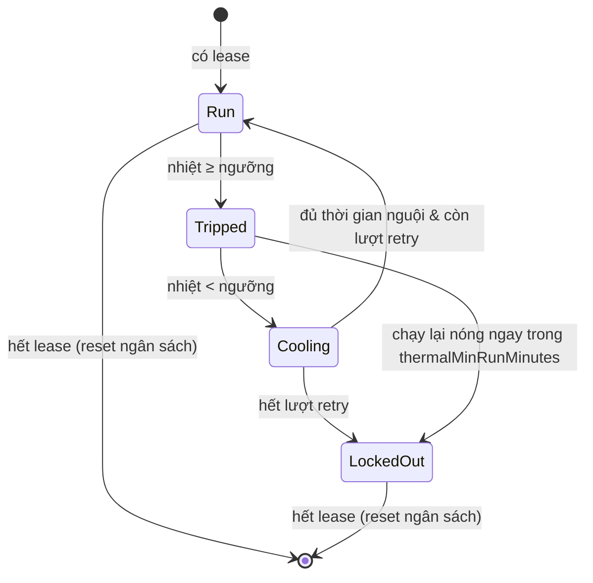

# 06. Vấn đề người dùng báo cáo & Phân tích kỹ thuật (User-Reported Issues)

Ghi nhận các phản hồi thực tế từ người dùng NonSleep, phân tích nguyên nhân gốc rễ và biện pháp đã triển khai trong ứng dụng.

---

## Issue #1 — "Gập máy lại thì máy khá nóng"

### 1.1 Mô tả hiện tượng
Người dùng chạy AI coding agent (Claude Code, Cursor) hoặc tác vụ nặng, bật NonSleep rồi gập nắp máy. Sau một thời gian, vỏ máy nóng lên rõ rệt.

### 1.2 Nguyên nhân gốc rễ (Root Cause)
Đây là hệ quả nhiệt động lực học của việc gập nắp, không phải do NonSleep tiêu tốn tài nguyên. Chi tiết phương trình nhiệt trở ở [`01_SCIENTIFIC_FOUNDATIONS.md`](01_SCIENTIFIC_FOUNDATIONS.md#2-nhiệt-động-lực-học-máy-tính-gập-nắp-clamshell-laptop-thermodynamics).

```
           MỞ NẮP                                    GẬP NẮP
   Đối lưu tự do qua bàn phím                Màn hình chặn đường thoát nhiệt
   h_air ≈ 5–15 W/(m²·K)                     khe khí δ < 1mm, k_air ≈ 0.026 W/(m·K)
            ▲ ▲ ▲                                   ───────────────
   ┌──────────────────┐                      ┌──────────────────┐
   │  Keyboard deck   │                      │  Keyboard deck   │
   │       SoC        │                      │       SoC        │
   └──────────────────┘                      └──────────────────┘
   R_deck thấp                               R_deck = R_open + R_gap + R_display
```

Ba yếu tố cộng hưởng:
1. **Mất đường tản nhiệt qua bàn phím:** 25–35% nhiệt lượng bình thường thoát qua mặt bàn phím bị chặn hoàn toàn.
2. **Tải công việc không đổi:** Agent vẫn chạy 100% công suất CPU/GPU — đây chính là mục đích của NonSleep.
3. **Môi trường kín:** Nếu đặt trong balo/trên nệm, mặt đáy nhôm (đường thoát nhiệt cuối cùng) cũng bị bịt.

### 1.3 Biện pháp đã triển khai trong app

| Cơ chế | File nguồn | Mặc định | Mô tả |
| :--- | :--- | :---: | :--- |
| `thermalLimit` | `ThermalGuard.swift` | `serious` | Ngưỡng nhiệt dừng chế độ gập nắp, **người dùng tự chỉnh** xuống `fair`/`nominal` nếu máy nóng. |
| `backpackThermalLimit` | `ThermalGuard.swift` | `fair` | Ngưỡng nghiêm ngặt hơn khi máy bị kẹp kín (gập nắp + dùng pin + không màn hình ngoài). |
| `sleepWhenDone` | `NonSleep.swift` | `true` | Khi cắt vì nóng lúc nắp đang gập, máy **ngủ ngay lập tức** — cách hạ nhiệt nhanh nhất có thể. |
| `thermalRetryLimit` | `ThermalGuard.swift` | `3` | Số lần tự chạy lại sau khi máy nguội, tránh việc máy cứ nóng–nguội–nóng vô hạn. |
| `thermalCooldownMinutes` | `ThermalGuard.swift` | `3` | Thời gian bắt buộc nằm dưới ngưỡng trước khi được chạy lại. |
| `thermalMinRunMinutes` | `ThermalGuard.swift` | `5` | Chạy lại mà nóng lại trong thời gian ngắn hơn mốc này ⇒ khoá hẳn, không thử tiếp. |

Máy trạng thái (state machine) quản lý retry nằm ở `ThermalGuard.step(power:policy:now:)` — hàm thuần (pure function), được lưu chung ở `thermal-guard.json` để CLI, app menu bar và reaper dùng chung một ngân sách retry.



### 1.4 Khuyến nghị cho người dùng
1. Hạ `thermalLimit` xuống `fair` (hoặc `nominal` nếu muốn cắt ngay khi máy chớm nóng).
2. Đặt máy trên mặt phẳng cứng, thoáng khí — không để trên nệm, chăn, trong balo kín.
3. Theo dõi số lần nóng bằng `nonsleep status` (hiện `overheats N · auto-resumes X/Y`).

---

## Issue #2 — "Dùng 4G phát Wi-Fi thì bị ngắt mạng giữa chừng, Wi-Fi router thì không"

### 2.1 Kết luận: Không có cảm biến chuyển động nào liên quan
MacBook **không có cảm biến chuyển động (motion sensor) ảnh hưởng tới mạng**. Cảm biến duy nhất liên quan đến việc gập nắp là **cảm biến Hall (Hall effect clamshell sensor)**, chỉ báo trạng thái đóng/mở nắp cho `IOPMrootDomain`, hoàn toàn không tác động đến Wi-Fi/Bluetooth.

### 2.2 Nguyên nhân gốc rễ

```
         [ Gập nắp MacBook ]
                  │
      ┌───────────┴────────────┐
      ▼                        ▼
Suy hao ăng-ten bản lề   macOS hạ công suất Wi-Fi
   (−5 đến −15 dB)       (low-power DTIM polling)
      └───────────┬────────────┘
                  ▼
   Điện thoại thấy lưu lượng ≈ 0
                  ▼
  Hotspot tự tắt để tiết kiệm pin điện thoại
```

Ba cơ chế cộng hưởng, giải thích tại sao chỉ hotspot bị ngắt còn router thì không:

1. **Cơ chế tự ngắt hotspot phía điện thoại:** iPhone/Android tắt phát sóng khi không thấy client gửi traffic trong khoảng 60–90 giây, nhằm tiết kiệm pin. Router Wi-Fi cắm điện liên tục nên không bao giờ làm điều này.
2. **macOS hạ công suất Wi-Fi khi gập nắp:** Card Wi-Fi chuyển sang chế độ polling tiết kiệm điện (DTIM sleep), tần suất gửi gói keep-alive giảm mạnh → điện thoại hiểu nhầm là máy đã ngắt.
3. **Suy hao sóng RF tại bản lề:** Dải ăng-ten Wi-Fi/Bluetooth của MacBook nằm ở thanh bản lề (clutch cover). Khi gập nắp, vỏ nhôm che một phần dải ăng-ten gây suy hao 5–15 dB. Router công suất lớn vẫn vượt qua được; sóng yếu từ điện thoại thì rớt gói.
4. **Kênh điều khiển Bluetooth/AWDL (với iPhone):** Personal Hotspot duy trì một kênh BLE song song; chu kỳ quét giãn ra khi gập nắp làm iPhone tưởng kết nối đã mất.

### 2.3 Ranh giới trách nhiệm của NonSleep
NonSleep **không thể và không nên** can thiệp vào tầng mạng:
- Bất biến kiến trúc của dự án là **zero network** (không `URLSession`, không socket, không telemetry). Thêm bất kỳ mã mạng nào sẽ phá vỡ cam kết air-gapped vốn là điểm tin cậy lớn nhất với cộng đồng.
- Việc ngắt hotspot nằm ở firmware điện thoại và driver Wi-Fi của macOS, nằm ngoài phạm vi của cờ `pmset disablesleep`.

### 2.4 Giải pháp cho người dùng (đã ghi vào README)

| Giải pháp | Hiệu quả | Ghi chú |
| :--- | :---: | :--- |
| **USB tethering qua cáp sạc** | ✅ Triệt để | Điện thoại hiện ra như một interface có dây; không bên nào tự idle-out. Vừa chia mạng vừa sạc. |
| iPhone: *Maximize Compatibility* | ⚠️ Cải thiện | Ép về băng tần 2.4 GHz, xuyên qua nắp nhôm tốt hơn 5 GHz. |
| Cắm sạc cho điện thoại khi phát | ⚠️ Cải thiện | Điện thoại đang sạc ít áp dụng chính sách tiết kiệm pin hơn. |
| Dùng Wi-Fi router | ✅ Không bị | Router không bao giờ tự ngắt client. |

---

## Giá trị truyền thông rút ra (Marketing Takeaway)

Hai vấn đề này nên được đưa thẳng vào mục **FAQ / Troubleshooting** của README và các bài đăng Reddit/Hacker News:
1. **Chủ động nói về nhiệt độ** biến điểm yếu thành điểm mạnh: NonSleep là công cụ duy nhất trong phân khúc có ngưỡng nhiệt **người dùng tự cấu hình** kèm cơ chế tự chạy lại có giới hạn — `caffeinate`, Amphetamine, KeepingYouAwake đều không có bất kỳ cơ chế bảo vệ nhiệt nào.
2. **Giải thích rõ chuyện hotspot** chứng minh dự án hiểu sâu tầng hệ thống và trung thực về giới hạn phạm vi (zero network), đúng thứ cộng đồng Hacker News đánh giá cao.
